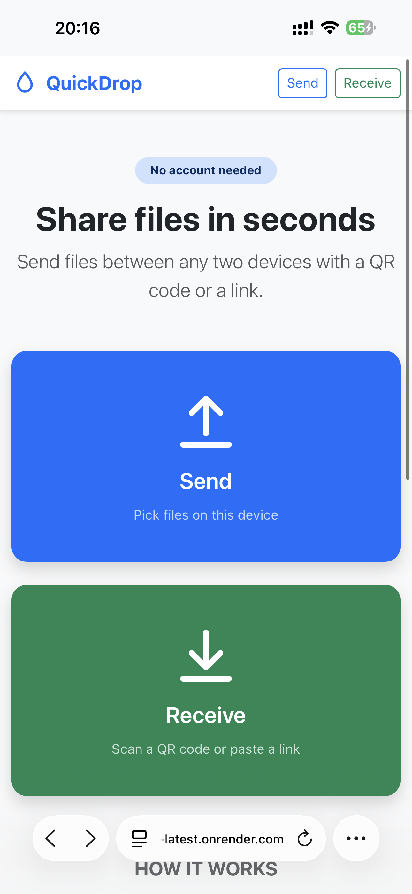
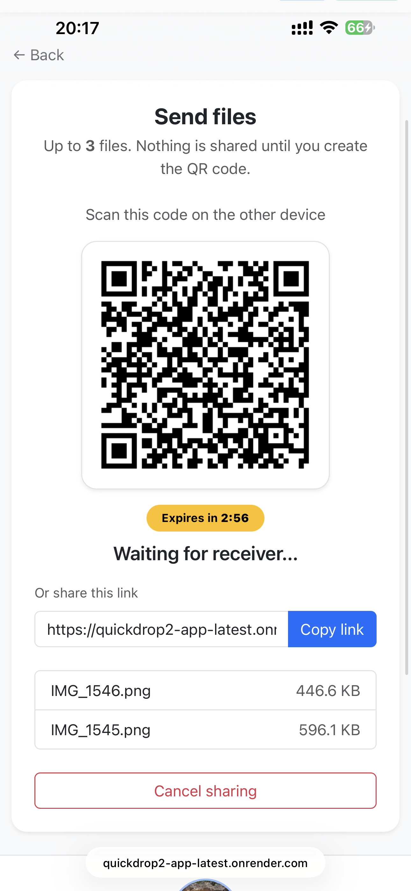
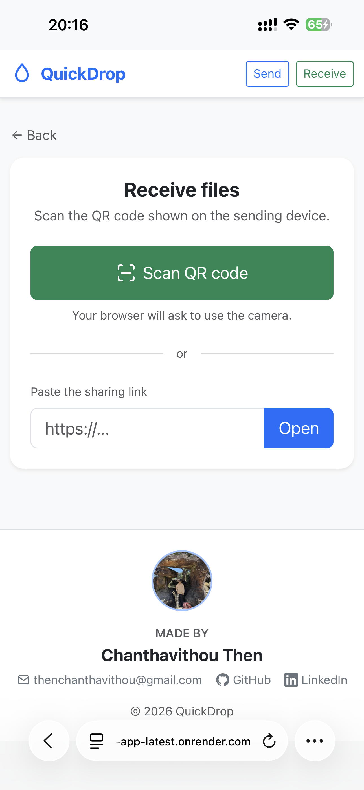

# QuickDrop

**Share files between any two devices with a QR code. No accounts, no app to install.**
🔗 **Live demo:** [https://quickdrop.example.com](https://quickdrop2-app-latest.onrender.com/)

QuickDrop works PC → Mobile, Mobile → PC, Mobile → Mobile and PC → PC. The sender uploads files, gets a QR code, and the receiver scans it and downloads. The two devices do **not** need to be on the same network.

---

## Screenshots

<table>
  <tr>
    <th align="center">1. Home</th>
    <th align="center">2. Send: share the QR code</th>
    <th align="center">3. Receive: scan or paste the link</th>
  </tr>
  <tr>
    <td align="center"></td>
    <td align="center"></td>
    <td align="center"></td>
  </tr>
</table>

---

## Features

- **Two-way sharing:** any device can send and any device can receive
- **QR code or link:** scan with the camera, or paste the link if the camera isn't available
- **Live status:** the sender sees each step as it happens through Server-Sent Events (receiver connected, downloading *n/m*, completed, disconnected, expired, cancelled)
- **Pick what you download:** the receiver chooses which files to take
- **Short-lived sessions:** files are deleted as soon as the transfer completes, expires or is cancelled
- **Secure by default:** random 256-bit tokens, HttpOnly cookies, CSRF protection, CSP, upload allow-list and rate limiting
---
